  <picture>
    <source media="(prefers-color-scheme: dark)" srcset="assets/banner-dark.svg">
    
  </picture>

  <picture>
    <source media="(prefers-color-scheme: dark)" srcset="assets/stats-dark.svg">
    
  </picture>

## Sobre mí

| Dato | Detalle |
|---|---|
| **Trabajo** | Software Engineer @ Mandu |
| **Formación** | Ingeniería de Software · UPC (8.º ciclo) |
| **Entorno** | CachyOS · VS Code |
| **Hobbies** | Entrenamiento, Fortnite |
| **Contacto** | ronald.rk15@gmail.com |

## Lenguajes

<picture>
    <source media="(prefers-color-scheme: dark)" srcset="assets/languages-dark.svg">
    
  </picture>

## Actividad del último año

<picture>
    <source media="(prefers-color-scheme: dark)" srcset="assets/contributions-dark.svg">
    
  </picture>

  Métricas generadas automáticamente cada día · última actualización 2026-10-22

